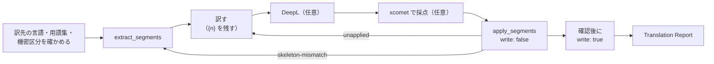

# s1000d-translate-skill

[English](./README.md) | **日本語**

[](https://opensource.org/licenses/MIT)

S1000D® のデータモジュール（DM）を翻訳する Claude Skill です。訳した DM は同じ DMC で、`language` だけが違います。`extract_segments` で DM から文を取り出し、LLM が訳し、任意で xcomet が訳文を採点し、低得点の文は DeepL の訳と比べて採用を決め、`apply_segments` で DM に戻します。

> [!IMPORTANT]
> このプロジェクトは ASD（Aerospace, Security and Defence Industries Association of Europe）とは無関係の個人プロジェクトです。S1000D® は ASD の登録商標です。

> [!NOTE]
> Skill の指示（`SKILL.md`、`references/`）は日本語で書いています。会話の言語にかかわらず Claude はこれに従います。DM の元の言語と訳先の言語は問いません。

## 何をするか

このリポジトリは MCP サーバーではなく、Markdown の手順書です。writer サーバーは翻訳も採点もしません。文を渡し、訳した文を戻すだけです。訳すのは LLM で、採点は別の道具です。



- 文の中のインライン要素は `{1}`、`{2}` に置き換わっています。訳文には、各プレースホルダーを 1 回ずつ残します。`{{` と `}}` は文字としての波括弧です。
- プレースホルダーが合わない文、知らない `id`、重複した `id` は適用されず、`unapplied[]` に出ます。元の文が残ります。
- 取り出したあとに DM が変わると、`apply_segments` は `skeleton-mismatch` で止まります。Skill は取り出しからやり直します。
- xcomet の得点の閾値は、このスタックの翻訳の試行で使った値から始めます。`skills/s1000d-translate/references/scoring.md` を参照してください。
- `extract_segments` が出さない文（識別・状態部のデータ制限の文など）は元の言語のまま残ります。報告に一覧を書きます。

スタックの 4 つの Skill に共通の原則です。

1. Skill は XML を書きません。
2. 判定はサーバーが下し、Skill は説明します。得点は xcomet の値をそのまま写します。
3. `fixes[]` の候補の外の値を使いません。
4. `write: true` の前に利用者に確かめます。
5. 検証状態を必ず報告します。`schema-not-found` と `not-run` は「合格」ではありません。S1000D への準拠は判定しません。
6. 必須の MCP が無いときは止まり、接続の方法を伝えます。任意の MCP が無いときは「未実施（ツール未接続）」と報告します。

DeepL に本文を送る前に、DM の `securityClassification` を利用者に見せ、送ってよいかを確かめます。

## 前提の MCP

| MCP | 必須 | 役割 | 最低版 |
|---|---|---|---|
| [@shuji-bonji/s1000d-writer-mcp](https://www.npmjs.com/package/@shuji-bonji/s1000d-writer-mcp) | 必須 | `extract_segments`、`apply_segments` | 0.1.1 |
| [xcomet-mcp-server](https://www.npmjs.com/package/xcomet-mcp-server) | 任意 | `xcomet_batch_evaluate`（採点） | 0.7.0（確認した版） |
| DeepL の MCP | 任意 | `translate-text`、用語集 | - |
| [@shuji-bonji/s1000d-reader-mcp](https://www.npmjs.com/package/@shuji-bonji/s1000d-reader-mcp) | 任意 | 機密区分の確認、訳した DM の読み取り | 0.7.1 |

`s1000d-writer-mcp` は `plugin.json` の `dependencies` に入っています。writer サーバーには、利用者ご自身が入手した S1000D の配布物（`S1000D_SPEC_DIR`）と CSDB のフォルダー（`S1000D_CSDB_DIR`）が要ります。

## インストール

```bash
/plugin marketplace add shuji-bonji/claude-plugins
/plugin install s1000d-writer-mcp@shuji-bonji
/plugin install s1000d-translate@shuji-bonji
```

Claude Code に手動で入れるときは、`skills/s1000d-translate/` を `~/.claude/skills/s1000d-translate` にコピーします。Cowork では、Releases の `.plugin` ファイルをアップロードします。

## 用語集

用語集は、2 列の CSV、Markdown の表、DeepL の用語集のいずれかで渡します。`skills/s1000d-translate/references/glossary.md` を参照してください。DeepL の用語集の作成は `deepl-glossary-translation` Skill の仕事です。

## ディレクトリ構成

```text
s1000d-translate-skill/
├── .claude-plugin/plugin.json
├── skills/s1000d-translate/
│   ├── SKILL.md
│   └── references/        scoring.md, glossary.md, report.md
├── evals/trigger-eval.json
├── .github/workflows/release.yml
├── README.md / README.ja.md
├── CHANGELOG.md
└── LICENSE
```

## ライセンス

MIT。S1000D の仕様書・XML スキーマ・既定 BREX・公式サンプルは、利用条件により再配布できないため含みません。ASD とは無関係の個人プロジェクトです。S1000D® は ASD の登録商標です。
