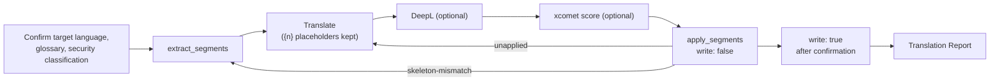

# s1000d-translate-skill

**English** | [日本語](./README.ja.md)

[](https://opensource.org/licenses/MIT)

A Claude Skill that translates S1000D® data modules (DMs). The translated DM has the same DMC; only `language` differs. The Skill takes the sentences out of a DM with `extract_segments`, has the model translate them, optionally scores the translations with xcomet and compares low-scoring ones with DeepL, and puts them back with `apply_segments`.

> [!IMPORTANT]
> This is a personal project and is not affiliated with ASD (Aerospace, Security and Defence Industries Association of Europe). S1000D® is a registered trademark of ASD.

> [!NOTE]
> The skill instructions (`SKILL.md`, `references/`) are written in Japanese. Claude follows them regardless of the conversation language. Source and target languages of the DM can be any pair.

## What it does

This repository is not an MCP server. It is a Markdown playbook. The writer server does not translate and does not score; it only hands out sentences and puts translated sentences back. Translating and scoring belong to the model and to other tools.



- Inline elements are replaced by `{1}`, `{2}` in the sentences. The translation must keep each placeholder exactly once. `{{` and `}}` stand for literal braces.
- A sentence with a wrong placeholder, an unknown `id` or a duplicate `id` is not applied and is listed in `unapplied[]`. The original sentence stays.
- If the DM changed after extraction, `apply_segments` stops with `skeleton-mismatch`. The Skill starts again from extraction.
- Thresholds for xcomet scores start from the values used in the stack's own translation trial. See `skills/s1000d-translate/references/scoring.md`.
- Sentences that are not offered by `extract_segments` (for example, the data restriction texts of the status section) stay in the source language. The report lists them.

Principles shared by the four Skills of the stack:

1. The Skill never writes XML.
2. The servers decide; the Skill explains. Scores are copied from xcomet as is.
3. It does not use a value outside the candidates of `fixes[]`.
4. It asks the user before `write: true`.
5. It always reports the verification status. `schema-not-found` and `not-run` are not "valid". S1000D conformance is not decided.
6. If a required MCP is not connected, it stops and says how to connect it. A missing optional MCP is reported as "not performed (tool not connected)".

Before sending text to DeepL, the Skill shows the `securityClassification` of the DM and asks the user whether sending is allowed.

## Prerequisite MCPs

| MCP | Required | Role | Minimum version |
|---|---|---|---|
| [@shuji-bonji/s1000d-writer-mcp](https://www.npmjs.com/package/@shuji-bonji/s1000d-writer-mcp) | Yes | `extract_segments`, `apply_segments` | 0.1.1 |
| [xcomet-mcp-server](https://www.npmjs.com/package/xcomet-mcp-server) | No | `xcomet_batch_evaluate` (scoring) | 0.7.0 (version checked) |
| DeepL MCP | No | `translate-text`, glossaries | - |
| [@shuji-bonji/s1000d-reader-mcp](https://www.npmjs.com/package/@shuji-bonji/s1000d-reader-mcp) | No | Security classification, reading the translated DM | 0.7.0 |

`s1000d-writer-mcp` is listed in `dependencies` of `plugin.json`. The writer server needs the S1000D distribution you obtained yourself (`S1000D_SPEC_DIR`) and your CSDB folder (`S1000D_CSDB_DIR`).

## Installation

```bash
/plugin marketplace add shuji-bonji/claude-plugins
/plugin install s1000d-writer-mcp@shuji-bonji
/plugin install s1000d-translate@shuji-bonji
```

For a manual install in Claude Code, copy `skills/s1000d-translate/` to `~/.claude/skills/s1000d-translate`. For Cowork, upload the `.plugin` file from Releases.

## Glossary

The Skill reads a glossary as a two-column CSV, a Markdown table, or a DeepL glossary. See `skills/s1000d-translate/references/glossary.md`. Creating a DeepL glossary is the job of the `deepl-glossary-translation` Skill.

## Directory layout

```text
s1000d-translate-skill/
├── .claude-plugin/plugin.json
├── skills/s1000d-translate/
│   ├── SKILL.md
│   └── references/        scoring.md, glossary.md, report.md
├── evals/trigger-eval.json
├── .github/workflows/release.yml
├── README.md / README.ja.md
├── CHANGELOG.md
└── LICENSE
```

## License

MIT. This Skill does not include the S1000D specification, XML schemas, default BREX or official samples, because their terms of use do not grant redistribution. This is a personal project and is not affiliated with ASD. S1000D® is a registered trademark of ASD.
