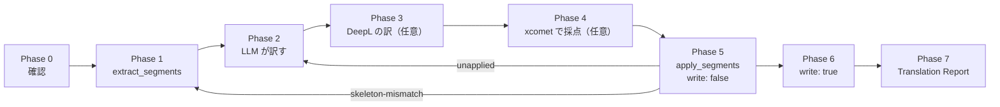

# s1000d-translate — DM の翻訳（同じ DMC、言語だけ違う DM）

DM を別の言語に訳し、同じ DMC で `language` だけが違う DM を作る Skill。
翻訳するのは LLM で、writer は文を取り出して戻すだけ。XML は一切書かない。

## 原則（4 つの Skill 共通）

1. **XML を書かない。** XML は writer が組み立てる。訳すのは文（`text`）だけで、タグも属性値も触らない。
2. **判定はサーバーが下し、Skill は説明する。** XSD・BREX・参照の判定は `apply_segments` の応答（`verification`）をそのまま根拠にする。訳の採点は xcomet の得点をそのまま写し、LLM が点数を付け直さない。
3. **候補の外の値を使わない。** `apply_segments` の応答に残った `fixes[]` は、候補の中から選ぶ。`confidence: none` のときと、`valueForm` が `range` / `pattern` のときは利用者に聞く。この Skill は `apply_fixes` を呼ばず、案を示すところまでにする。
4. **書き込む前に確かめる。** `write: true` は、利用者が訳先の言語・書き込み先・ファイル名を確認してからにする。
5. **検証状態を必ず報告に書く。** `schema-not-found` と `not-run` を「合格」と書かない。S1000D への準拠は判定しない。
6. **前提の MCP が無いときは止まる。** 必須の MCP が無ければ、その旨と接続の方法を伝えて止まる。任意の MCP が無いときは、報告の該当項目に「未実施（ツール未接続）」と書く。

## 前提 MCP

| MCP | 必須/任意 | 役割 | 最低版 |
|---|---|---|---|
| s1000d-writer-mcp | **必須** | `extract_segments`（文の取り出し）、`apply_segments`（差し戻しと検証） | 0.1.1 |
| xcomet-mcp-server | 任意 | `xcomet_batch_evaluate`（訳文の採点）、`xcomet_detect_errors`（誤りの箇所） | 0.7.0 |
| DeepL の MCP | 任意 | `translate-text`（比較用の訳）、用語集（`list-glossaries`）。用語集の作成は `deepl-glossary-translation` Skill | — |
| s1000d-reader-mcp | 任意 | `read_data_module`（機密区分の確認、訳した DM を読んで見せる） | 0.7.0 |

writer が無いときは、止まって次を伝える。

- `/plugin install s1000d-writer-mcp@shuji-bonji`
- 設定ファイル `~/.config/s1000d-stack/config.json` の `specDir`（利用者が入手した S1000D の配布物）と `csdbDirs`（プロジェクトの CSDB）。環境変数が MCP に渡らない環境では、こちらに書く

任意の xcomet は `/plugin install xcomet-mcp@shuji-bonji`（npm のパッケージ名は `xcomet-mcp-server`）で入る。無ければ採点は「未実施（ツール未接続）」と報告に書く。

## 全体の流れ



## 手順

### Phase 0 — 対象・訳先・材料を確かめる

利用者に次を確かめる。分かっていることは聞き直さない。

- 対象の DM: DMC かファイルのパス。DM のフォルダーなら 1 件ずつ Phase 1〜6 を回す
- **訳先の言語**: `languageIsoCode` と `countryIsoCode`（例: `en` / `US`、`ja` / `JP`）。元の言語は `extract_segments` の `language` に出る
- 用語集と文体の決まり: `references/glossary.md` の形式。無ければ「用語集なし」で進める
- **`csdbDirs`**: 書き込み先（先頭のフォルダー）と参照の検証に要る。分からなければ `write: false` までで進める
- 同じ DMC の訳先言語の DM が既にあるか（`list_data_modules` を `filter` の `infoCode` などで絞り、各行の言語で確かめる。reader があるとき）。あれば上書きするかを聞く（`overwrite` は利用者が明示したときだけ）

### Phase 1 — 文を取り出す

1. **機密区分の確認**（reader があるとき）: `read_data_module` を `section: "outline"` で呼び、`securityClassification` を見る。値の意味は解釈しない。値を利用者に見せ、**本文を外部のサービス（DeepL など）に送ってよいか**を確かめる。「送らない」なら Phase 3 は行わない。reader が無いときは、利用者に同じ確認をする
2. `extract_segments`（`path` か `xml`）を呼ぶ。既定は全種類の文。`include` で種類を絞ると、絞った外の文は訳されず元の言語のまま残る。`maxSegments` で切った分も同じなので、全文を訳すときは付けない
3. 応答の読み方:
   - `skeletonHash`: 文を全部空にした XML のハッシュ。`include` や `maxSegments` に左右されない。**Phase 5 まで保存する**
   - `counts`: 種類ごとの件数
   - `segments[]`: `id`（安定した短い文字列）、`xpath`、`element`、`category`（title / para / step / admonition / table / caption）、`context`（訳の手がかり）、`text`、`placeholders[]`
   - `_notes`: 切れた件数など
4. 属性値・DMC・ICN・適用性の式・id は取り出されない。識別・状態部のデータ制限の文などは取り出されない文がある。訳されない文は元の言語のまま残るので、Phase 7 に書く

### Phase 2 — LLM が訳す

`segments[]` の 1 件につき、`id` と訳文 `text` の対を作る。規則:

1. **プレースホルダー `{1}` `{2}` を、訳文に元と同じ数だけ、1 回ずつ残す。** 番号を変えない。増やさない。減らさない。語順は訳先の言語に合わせて動かしてよい
2. **`{{` と `}}` は文字としての `{` `}`。** 訳文でも `{{` `}}` のまま書く。それ以外の波括弧は書かない
3. **`context` を手がかりにする。** `dmTitle/techName` は部品名、`step 3` は手順の 3 番目、`applic displayText` は適用性の表示文、警告の種類（warning / caution / note）は文の強さ。手順の文は命令形（日本語は文体を DM の中で揃える）
4. **1 つの `id` に 1 つの訳文。** 文を結合しない、分割しない、並べ替えない。`id` を足さない
5. 数値・単位・型番・部品の識別子は変えない。用語集があれば `references/glossary.md` のとおりに訳す
6. 訳せない・訳してはいけない文（固有名詞だけの題など）は、元の文をそのまま `text` に入れる（`applied` に数えられ、変わらない）。その `id` を Phase 7 の「そのまま」の欄に書く
7. 文脈が足りず意味が決まらない文は、推測で訳さず、利用者に聞く

### Phase 3 — DeepL の訳を取る（DeepL の MCP があり、Phase 1 で送ってよいとき）

1. 用語集を使うなら `list-glossaries` で言語対の合うものを選ぶ。`glossaryId` を渡すときは `sourceLangCode` が必須（省略すると自動検出になり、用語集が適用されない）
2. `translate-text`（`sourceLangCode`、`targetLangCode`、`glossaryId`、`context`）で、**Phase 2 と同じ文**を訳す。`context` には、保守手順の DM であること、`{1}` が相互参照の置き場所で変えてはいけないことを書く
3. 2026-10-28 の試行では、`text` に配列を渡すと、応答が 1 つの文字列に連結されて返り、文の境界が分からなくなった。**文ごとに 1 回ずつ呼ぶ**か、境界を確かめられる形で受ける
4. 返ってきた訳文のプレースホルダーを数える。DeepL が `{1}` を消す、動かす、全角にすることがある。合わない訳文は採用しない
5. DeepL は比較用。DeepL の訳を無条件に採用しない

### Phase 4 — xcomet で採点する（xcomet-mcp があるとき）

閾値と読み方は `references/scoring.md`。

1. `xcomet_batch_evaluate` に、`pairs: [{ source, translation }]`（`source` は元の `text`、`translation` は Phase 2 の訳文）、`source_lang`、`target_lang`（2 文字、例 `en` / `ja`）を渡す。1 回の上限は 500 対、1 文は 10000 文字まで
2. DeepL の訳も採点する（Phase 3 を行ったとき）。2 つの訳を同じ `source` で並べる
3. 応答の `results[]`（`index`、`score`、`error_count`、`has_critical_errors`、`errors[]`）を、文の `id` に対応させて表にする。`index` は `pairs` の位置
4. `scoring.md` の線で、各文を次の 3 つに分ける。
   - 合格: そのまま Phase 5 へ
   - 低得点: DeepL の訳と比べて採用を決める。差が小さいときは、`errors[]` の `text` と `severity` を見て、意味の誤りか、文体や箇条書きの書き方による減点かを判断し、理由を書く
   - critical あり（`has_critical_errors: true`）: 必ず訳を見直す。採用して先へ進める場合は、利用者に理由を伝えて確かめる
5. 採点は意味の対応を見る道具で、用語の一致は見ない。用語は `glossary.md` と照らして確かめる
6. xcomet が無いときは、報告の採点の欄に「未実施（ツール未接続）」と書く。LLM が点数を代わりに付けない

### Phase 5 — 差し戻す（`write: false`）

1. 差し戻す前に、各訳文の `{n}` の数が元と合うかを数えて確かめる
2. `apply_segments` を `path`（または `xml`）、`skeletonHash`、`segments: [{ id, text }]`、`language`（訳先）で呼ぶ。`issueInfo` を渡すと訳した DM の版を指定できる（省略すると元の版のまま）。`csdbDirs` も渡す。`write` は省略（false）
3. 応答の読み方:

| 項目 | 意味 |
|---|---|
| `applied` | 訳文を適用した文の数（元の文と同じで変えなかった文を含む） |
| `unapplied[]` | 適用しなかった文。`id` と `reason`。元の文が残る |
| `fileName` | 言語だけ違う `DMC-….XML`（例 `…_JA-JP.XML`） |
| `verification` | 訳した DM の XSD・BREX・参照の検証状態 |
| `fixes[]` | 残った修正の案。訳に由来しないものが多い（参照の `no-csdb` など） |
| `error.code` | `skeleton-mismatch` など。応答が `xml` でなく `error` で返る |

4. **`unapplied[]` の扱い**（`reason` ごと）:
   - `placeholder-mismatch`: `{n}` が欠けた、重複した、番号が違う、`{` `}` の書き方が壊れた。該当の訳文を直して Phase 5 をやり直す
   - `unknown-id`: 取り出していない `id`。`id` の写し間違い。`segments[]` と照らして直す
   - `duplicate-id`: 同じ `id` を 2 回渡した。1 つにする
   - 直さずに先へ進むときは、元の言語のまま残ることを利用者に伝える
5. **`skeleton-mismatch`**: `error.expected` と `error.actual` が違う。取り出したあとに DM が変わった。**古い `skeletonHash` で再試行しない。** Phase 1 からやり直し、訳は `id` と元の `text` が同じ文だけ使い回す（元の `text` が変わった文は訳し直す）
6. `verification` を読む。`schema.state` が `invalid` なら訳文が原因でないかを `fixes[]` の `location` で確かめる。`schema-not-found` と `not-run` は未検証と書く

### Phase 6 — 書き込む

利用者に、訳先の言語、書き込み先（`csdbDirs` の先頭）、`fileName`、未訳・`unapplied` の件数、`verification` を見せて確認してもらう。確認後に、同じ引数で `write: true` を付けて呼ぶ。

- 応答の `written`（書いたファイル）か `writeSkipped`（`no-csdb-dir`、`write-conflict`、`schema-invalid`）を読む。書かなかったときは理由を伝えて止まる
- `write-conflict`（同じ名前のファイルがある）は、利用者が上書きを明示したときだけ `overwrite: true`
- `schema-invalid` は、利用者が明示したときだけ `allowInvalid: true`
- reader があれば、書いた DM を `read_data_module`（`section: "outline"`）で読み、訳先の言語になっていることを利用者に見せる

### Phase 7 — Translation Report

`references/report.md` の雛形で返す。

## 場面ごとの判断

| 場面 | 判断 |
|---|---|
| `applied` が取り出した文の数より少ない | `unapplied[]` の件数と合うか確かめる。合わなければ、渡した `segments` の件数と `id` を数え直す |
| `unapplied[]` が `placeholder-mismatch` | 元の `placeholders[]` と訳文の `{n}` を並べて数える。日本語の語順に合わせて `{1}` を動かすのは構わない。消す・増やすは不可 |
| xcomet が `{` を minor の誤りとして出す | プレースホルダーが合っていれば無視する（`references/scoring.md`） |
| 文が 500 を超える | `xcomet_batch_evaluate` を 500 対ずつに分ける。`index` は分けた単位の位置なので、`id` との対応を呼び出しごとに作る |
| 訳先の DM が既にある（`write-conflict`） | 上書きしてよいかを聞く。同じ DMC・言語の DM を訳し直すのか、版（`issueInfo`）を上げるのかも確かめる |
| 訳した DM の `verification.references` が `unresolved`（`no-csdb`） | `csdbDirs` が渡っていない。訳に由来する問題ではない。渡して `write: false` の呼び出しをやり直す |
| 利用者が DM 以外の文書（PDF、Markdown）の翻訳を頼む | この Skill の対象外。DM でないと伝える |
| 利用者が訳文の文体（です・ます／だ・である）を指定していない | 利用者に聞く。聞けなければ、元の DM の文体に近い側を選び、報告に書く |
| 機密区分が付いていて、利用者が DeepL への送信を認めない | Phase 3 を行わない。報告の DeepL の欄に「送信なし（利用者の判断）」と書く。採点は xcomet がローカルで動く構成なら行える（外部に送るかは利用者に確かめる） |

## 応答の例（読み方の確認用）

`extract_segments` の 1 件と、それに対する訳文の対（手順 DM の抜粋）。

```json
{ "id": "pr.mp.st1.p1", "context": "step 1",
  "text": "Remove the stem, refer to:{1}",
  "placeholders": [{ "index": 1, "element": "dmRef", "xml": "…" }] }
```

```json
{ "id": "pr.mp.st1.p1", "text": "ステムを取り外す。参照:{1}" }
```

`{1}` は 1 回だけ残っているので適用される。同じ DM で、`pr.mp.st2.p1` の訳文から `{1}` を落とすと、`apply_segments` は `unapplied: [{ "id": "pr.mp.st2.p1", "reason": "placeholder-mismatch" }]` を返し、その文は英語のまま残る。取り出していない `id` を渡すと `reason` は `unknown-id` になる。`applied` は適用できた文の数だけを数える。

## やらないこと

- 訳の採点の代行（xcomet が無いとき LLM が点数を付ける）
- 文の結合・分割・並べ替え、`id` の追加
- 取り出されない文（データ制限の文、属性値、コメント）を訳したと書くこと
- DeepL への送信の確認前の送信
- S1000D への準拠の判定
- DM の翻訳以外（一般の文書・PDF の翻訳）
