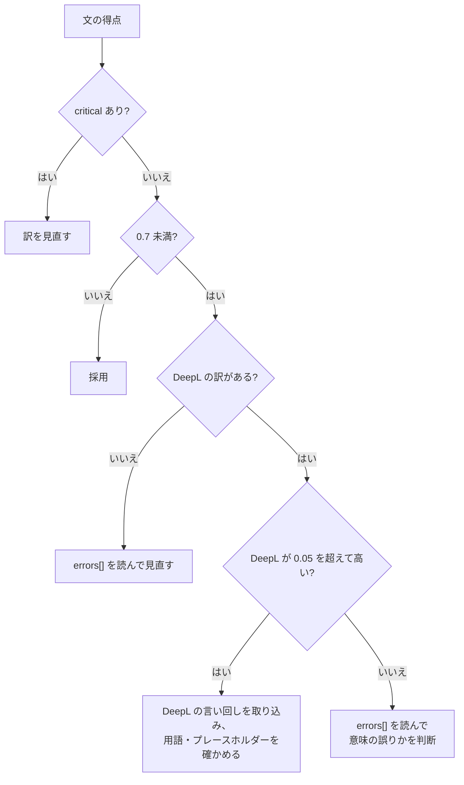

# 訳文の採点（xcomet）の閾値と読み方

SKILL.md の Phase 4 で読む。運用の前例は、このスタックの `docs/notes/i18n-trial.md`（サイトの 1 ページを Claude と DeepL で訳し、xcomet の `xcomet_batch_evaluate` で ja → en を採点した記録）。

## 閾値

> [!NOTE]
> 次の値は**出発点の値**で、プロジェクトの実績で見直す。i18n-trial.md の記録から次のように引いた。

| 値 | 出どころ | 使い方 |
|---|---|---|
| **0.7 未満** = 低得点 | 試行の 15 段落はすべて 0.74 以上（平均 Claude 0.879・DeepL 0.889）。後の 30 段落（平均 0.832）で 0.7 未満の 4 段落を読み直す対象にした。出発点の値 | 低得点の文は、DeepL の訳と比べて採用を決め、訳を見直す |
| **0.05** = 比べるときの差 | i18n-trial.md の結論「xcomet の差が 0.05 を超えて DeepL が高い段落について、言い回しを取り込む参考にする」 | DeepL の得点が自分の訳より 0.05 を超えて高いとき、DeepL の言い回しを取り込む候補にする。差が 0.05 以内なら同点とみなす |
| **`has_critical_errors: true`** | 試行は critical 0。critical は意味の誤りの印として扱う（出発点の値） | 得点にかかわらず、訳を必ず見直す |

試行では、平均が同点（0.879 と 0.889）でも、段落ごとの差は -0.133〜+0.092 あった。平均だけで訳の優劣を決めない。

## 低得点の文の扱い

1. `errors[]` の `text`（誤りの範囲の文字列）と `severity`（minor / major / critical）を読む
2. 次の減点は、意味の誤りではないことが多い（試行の観察）。理由を書いて採用してよい。
   - 箇条書きの先頭に置いた動詞句（"Reads a BREX." のような短い文）が、不完全な文と見なされた
   - 識別子が多い長文は得点が下がりやすい
   - 原文に無い展開（略語の展開など）が「原文に無い」と見なされた
   - `{1}` のような記号。`errors[]` に `{` が minor で出ることがある（2026-10-28 に DM の文で確認）。プレースホルダーが合っていれば無視してよい
3. 意味の誤り（major / critical で、誤り範囲が語の取り違えを指す）なら訳を直す
4. DeepL の訳を採るときは、次を確かめてから `segments` に入れる。
   - プレースホルダーの数と番号が元と同じ
   - 用語が `glossary.md` に合う（xcomet は用語の一致を見ない）
   - 文体が DM の中の他の文と揃う

## xcomet で測れないこと

試行で、DeepL の訳に次の問題があったが、xcomet は誤りとして検出しなかった。採点とは別に、人が（この Skill では用語集と照らして）確かめる。

- 用語の不一致（決めた対訳と違う語）
- 主語や文の種類の変更（「〜する」が命令に、または「私たち」が足される）
- 見出しや定型文の固定表記の崩れ

## 使い方の注意

- `xcomet_batch_evaluate` は、1 回に最大 500 対、1 文 10000 文字まで。DM 1 件の文は通常これに収まる
- `source_lang` と `target_lang` は 2 文字（`en`、`ja`）。国コードは付けない
- 既定は CPU。件数が多いと時間がかかる。`use_gpu` は利用者の環境による
- 全文を採点するのが重いときは、「人が通読しない DM」と「訳し直した文」に絞る（試行で採った運用）。絞ったときは、報告に採点した範囲を書く
- 得点は 0〜1 の数値で、サーバーの出力をそのまま写す。丸めた値を判定に使わない
